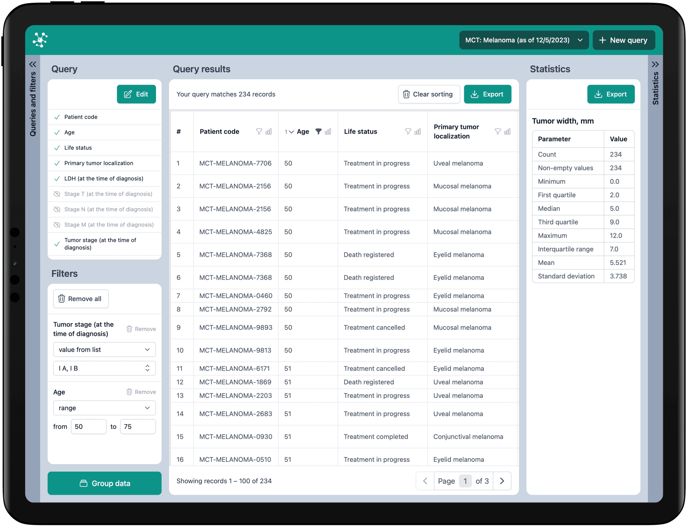

# Trial BI

[](https://github.com/gogent01/trial-bi-client/actions/workflows/ci.yml)

Trial BI is a system for analyzing data collected during clinical trials: researchers select fragments of the raw data, get preliminary insights, and export the fragments for further analysis in statistical software.

**Live demo:** https://trial-bi-client.vercel.app (randomly generated data for two demo trials)



### Features

- Selection of a clinical trial and of columns from any of its related tables.
- Support for 4 types of variables: number, date, text, and factor (a fixed list of values).
- Sorting by multiple columns.
- Filtering, with filter types depending on the variable type: "equals", "greater than", "greater than or equals", "less than", "less than or equals", "range", "starts with", "contains", "ends with", "values from the list".
- Hiding columns, and editing a query while keeping the filters and sorting of the remaining columns.
- Aggregation by one or more columns, with a choice of summary for every other column.
- Descriptive statistics for any variable type.
- Export of data and statistics to *.xlsx files.

## Trial BI Client

This repository contains only the front-end of the system. By default it uses an internal demonstration source of randomly generated data (`DemoRouter` in `src/data/Router.ts`). The client for the backend is also implemented (`APIRouter`, a REST API under `/api/1.0`), and there is an option to modify code for retrieving data from locally uploaded files.

To use the backend instead of the demo data, set `VITE_DATA_SOURCE=api` (for example, in `.env.local`). In development, Vite proxies `/api` requests to `http://localhost:3000`.

In the full system, a daily ETL job transforms the contents of the operational trial database into DuckDB, and the backend serves that data to this client.

### How it works

**Data model.** Each trial is a set of tables linked by foreign keys, forming a tree rooted at *Patients*: for example, Patients → Cancers → Surgical treatment. In the full system the tables come from the backend; in the demo they are generated in the browser.

**Query planner** (`src/data/QueryPlanner.ts`). The user picks columns from any tables. The planner orders the tables from the root down and adds the intermediate tables needed to connect them: selecting *Patients* and *Surgical treatment* also brings in *Cancers* (only its ID column), and two sibling tables such as *Cancers* and *Life status* are connected through their common parent.

**Joins** (`src/data/DemoDatabase.ts`). Tables are joined pairwise along their foreign keys (a left join), so the result has one row per record of the deepest table: a patient with two tumors appears twice. Records without matching records in a child table are kept, with empty cells in that table's columns. Selecting columns from two sibling tables produces every combination of their records for each patient. Columns with the same name in both tables get `.x` and `.y` suffixes, as in R's `merge()`.

**Filtering and sorting** (`src/classes/FilterTask.ts`). Filters depend on the variable type and are combined with AND. A range includes its lower bound and excludes the upper one. Sorting works by several columns at once; the header shows each column's sort order.

**Grouping** (`src/classes/Grouping.ts`). Rows are grouped by the selected columns. Every other column gets a summary: hide, count, mean, median, sum, first, last, nth value (counting from 1), unique values or all values (with a custom separator). The column is renamed accordingly, for example *Age (mean)*, and its type changes where needed (a count is a number, a list of values is text). *Ungroup* returns to the data as it was before grouping (`src/classes/StateStorage.ts`).

**Statistics** (`src/classes/ColumnStats.ts`). Calculated for one column over the filtered rows:
- numbers: count, non-empty values, minimum, quartiles, maximum, interquartile range, mean and standard deviation (quartiles use linear interpolation, R's default);
- factors: counts for every level and for missing values;
- dates: minimum and maximum;
- text: count and non-empty values.

**Export** (`src/classes/XlsxExport.ts`). Saves the visible columns of the filtered and sorted table, or the statistics table, to *.xlsx. ExcelJS is loaded only when exporting.

**Demo data** (`src/data/breast`, `src/data/melanoma`). Generated with Faker, with weighted distributions to look realistic. Each trial's data is built the first time the trial is used.

### Technologies
- TypeScript, Vue 3 (Composition API, `<script setup>`), Vite
- Tailwind CSS, Headless UI, Heroicons
- vue-i18n (English and Russian, picked from the browser language)
- simple-statistics, fast-sort, ExcelJS
- Vitest

### Installation and Launch

The project uses [pnpm](https://pnpm.io) (run `corepack enable` to get the version pinned in `package.json`).

```bash
pnpm install
pnpm start
```

Standard scripts for a Vue project:

```bash
pnpm type-check # type correctness checks
pnpm build # build the application to './dist' folder
pnpm lint # lint and auto-fix
```

Tests cover data filtering, descriptive statistics, query planning and joins, grouping summaries, and pluralization rules. They are located in the `__tests__` folder. To run tests in watch mode use the following command:

```bash
pnpm test
```

### Continuous Integration

Every push to `main` and every pull request runs type checks, linting (`pnpm lint:check`, which fails on any warning), tests (`pnpm test:ci`) and a production build in GitHub Actions (`.github/workflows/ci.yml`). Dependabot (`.github/dependabot.yml`) opens a monthly pull request with grouped minor and patch updates; major upgrades are done manually, while security updates arrive regardless.

### Structure

The application is built as a Single Page Application (SPA) and has one screen for working with data (`src/App.vue`). Key components of the application include:
- Data selection modal: `src/components/QueryEditOverlay.vue`
- Data aggregation modal: `src/components/GroupingOverlay.vue`
- Data table: `src/components/QueryResultTable.vue`
- Column list: `src/components/QueryList.vue`
- Filter list: `src/components/FilterList.vue`
- Descriptive statistics table: `src/components/StatisticsTable.vue`

The data logic lives outside the components:
- Data sources (demo and backend API): `src/data/Router.ts`
- Query planning and joins: `src/data/QueryPlanner.ts`, `src/data/DemoDatabase.ts`
- Filtering, grouping, statistics, export: `src/classes/FilterTask.ts`, `src/classes/Grouping.ts`, `src/classes/ColumnStats.ts`, `src/classes/XlsxExport.ts`

### User Journey

1. Choose a trial in the upper right corner of the screen and click the "New Query" button.
2. Select columns with data for display.
3. Apply filtering, sorting, and aggregation to the data. If necessary, edit the query (filters and sorting on the remaining columns are kept), ungroup the data, or create a new query.
4. See descriptive statistics for columns of interest.
5. Export the modified data table and descriptive statistics tables in *.xlsx format.
